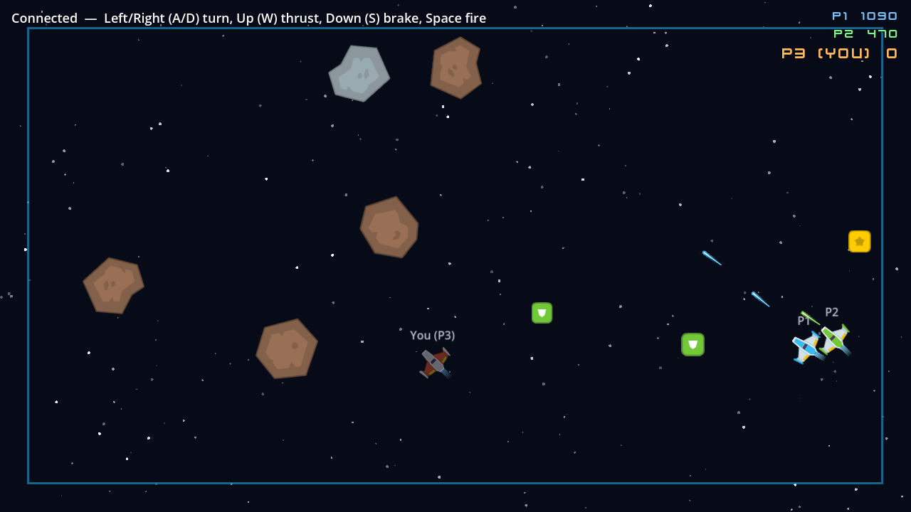
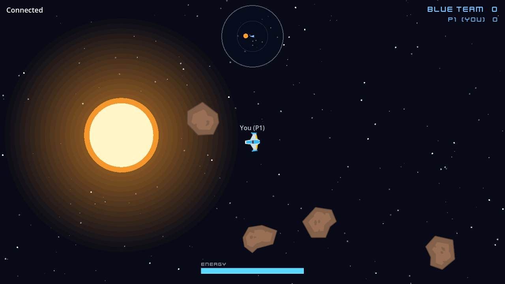
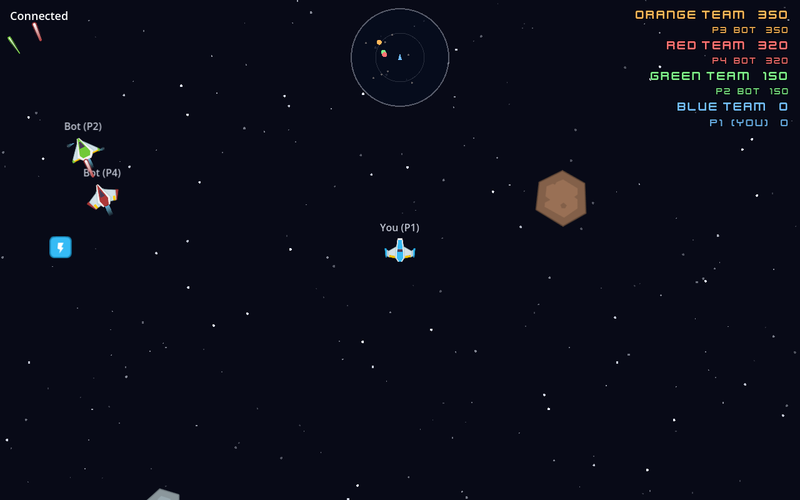
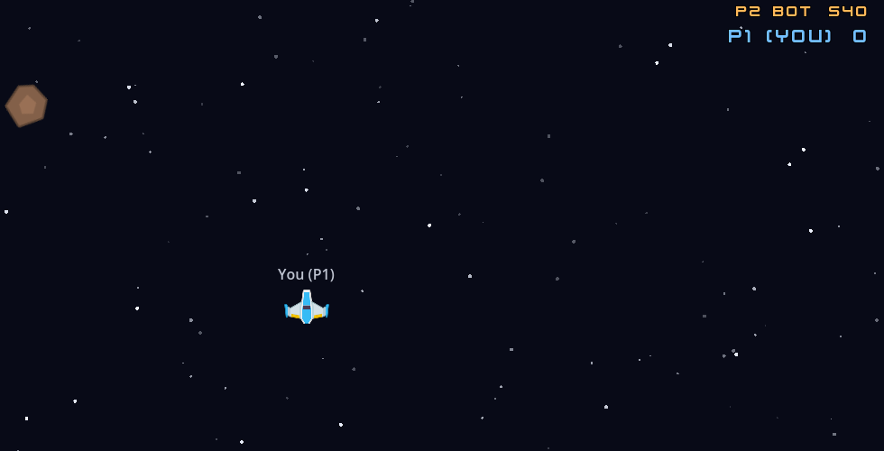
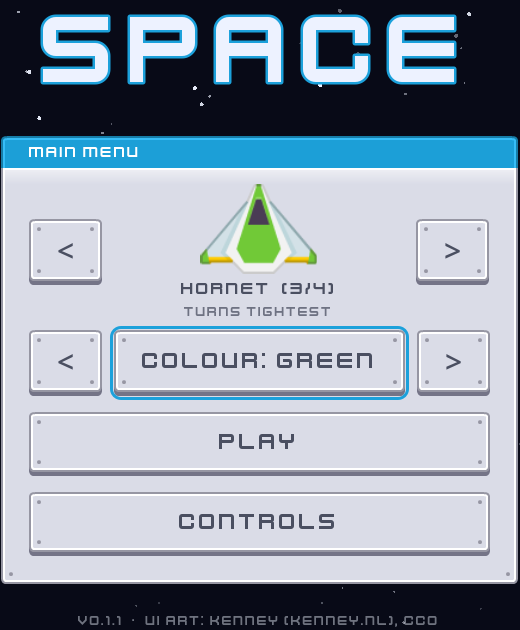
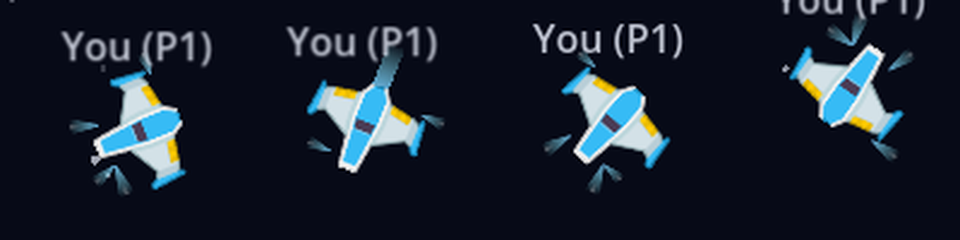
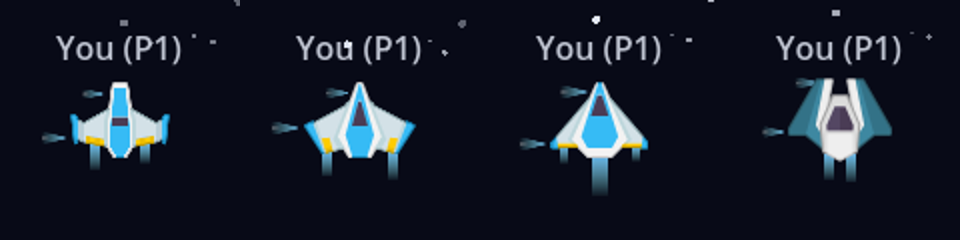
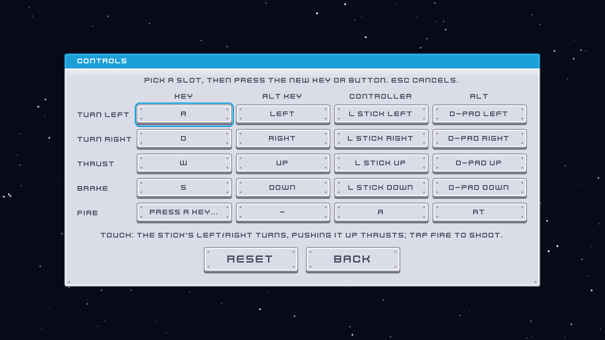

# Space

**Core loop:** team asteroid shooting with PvP. Fly a ship with momentum, shoot asteroids and ships of other teams, and pick up power-ups. Large rocks split into two medium rocks, and medium rocks into two small ones; smaller rocks are worth more (20 / 50 / 100). Hitting a rock with your ship destroys it, unless your shield takes the hit. You respawn where you were destroyed after 2 s, blinking and invulnerable for 2 s. Score is per player and shown top-right.

**Ships** (#31): pick one of four ships and its colour on the menu before Play (`SpaceShipPicker`); both are remembered (`user://space.cfg`). Left/Right (keys, D-pad, stick) or the arrows change the ship; Up moves to the colour button, where Left/Right change the colour. Colours are blue, green, orange and red, and **colours are teams** (below); **auto** (the default) puts you on the team with the fewest ships. Your colour also tints your shots.

**The star and energy:** a star sits at the centre of the map (`SpaceStar`, drawn in code by `SpaceStarView`).
- **Gravity** pulls ships and rocks towards it: `GRAVITY / r²`, capped at 1400 px/s² near the surface. At the spawn ring (900 px) it's a nudge (~90 px/s²); inside ~360 px it beats a Falcon's full thrust, so don't dive too deep. Shots fly straight (they live under a second).
- **Touching it** destroys a ship outright (no shield or spawn protection helps) and burns up rocks and shots. Nobody (re)spawns closer than 900 px (`SpaceStar.safe_spot`), and new rocks don't come in near it.
- **Energy** (0–100, bar bottom-centre): recharges at 40/s within 400 px of the star, falling off as 1/distance beyond (20/s at 800, 4/s at 4000), never below 1.5/s. Main engine 10/s, brake 6/s and strafe 8/s at full push; 7 per shot. When the pool can't pay, the engines get only the power it can (none when empty) and the guns don't fire; turning is free. Respawning refills it. So the fight is a loop: dive in to recharge, climb out to fight.
- **Rocks fall** without being replicated: each one's path is a `SpaceStar.Fall`, stepped in fixed 1/30 s steps from its spawn data (origin, velocity, server time), the same way on every peer, so they all agree. A late joiner steps each rock through its whole life once when it arrives (cheap: rocks are dropped once nobody's near them). A rock's pieces split off its current, gravity-bent velocity.
- **Bots** head back to recharge below 30 energy, keep 5 spare when shooting, and fly straight out if they get within 500 px of the star.
- The radar shows the star as an orange sun (on the rim when it's out of range): the way home to recharge.

**Teams, PvP and radar** (#35):
- **Teams:** your colour is your team. Auto joins the smallest team (on a tie, your seat's colour), and bots always join on auto, so teams stay even. Picking a colour joins that team however big it is.
- **PvP:** shots hit ships of other teams, never your own team (no friendly fire). A shield takes the hit; spawn protection (blinking) lets shots fly through. Shooting a ship down scores **200** (`SpaceSim.SHIP_KILL_POINTS`). The server decides every hit (`SpaceDirector`, swept like rock hits); a shot's team travels in its spawn data, so it counts even if its shooter has left.
- **Bots** attack enemy ships within 500 px before rocks (`SpaceBot`), so a lone player with bots has a fight on.
- **Scoreboard:** grouped by team, each team's total first, best team on top.
- **Radar** (`SpaceRadar`, top-centre): your heading as an arrow in the middle; other ships as dots in their team's colour (allies ringed, enemies solid) within 1500 px, and pinned to the rim beyond that, so you can always find the others; rocks in range as specks.

**Bots** (server-flown): the menu's **Bots** row (0–7) asks the server to fly that many bot ships. Only the first person into an empty match decides (the pick goes with the join request; later players' picks are ignored), and going back to select while alone lets you change it. Bots are ordinary ships spawned by the server (`ServerBots`, fake negative peer ids, labelled "Bot (P2)" and "bot" on the scoreboard), flown by `SpaceBot` reading the server's own state, with a random ship and colour. They take free seats only, one gives up its seat when someone joins a full match, and they all leave with the last person.

**Changing ship mid-game:** Esc (Start on a controller, the **Menu** button top-left on touch; remappable as "Ship select") despawns your ship and brings the menu back. Pick again and Play: you rejoin on the same connection, in the same seat, with your score. It's the generic `InputSetup.MENU` action: `main.gd` calls `GameBase.leave_to_select()` (the server checks the sender, removes that player and keeps the seat waiting) and Play sends the join request again. Games without a menu get their join button back instead.

| Ship | Art | Thrust | Top speed | Turn | Fire every |
|---|---|---|---|---|---|
| **Falcon**: all-rounder | `playerShip1` | 560 | 440 | 4.2 rad/s | 0.25 s |
| **Comet**: fastest, slow to fire | `playerShip2` | 700 | 540 | 3.8 rad/s | 0.32 s |
| **Hornet**: turns tightest | `playerShip3` | 520 | 420 | 5.6 rad/s | 0.22 s |
| **Gunship**: fires fastest, heavy | `Enemies/enemy*2` (black for orange players) | 440 | 360 | 3.4 rad/s | 0.15 s |

All hulls are the same size to hit, and rapid fire is 0.1 s for all. The pick travels in the join request (`GameBase.join_choice`, `{"hull", "color"}`): the server claims your seat when you connect, but spawns your ship only when the request arrives. `SpaceArena._sanitize_choice` rebuilds it from those two keys (hull clamped, auto or out-of-range colour → the seat's), so the spawn data carries `"hull"` and `"color"` and every peer builds the right ship from the first frame.

**Infinite map** (#29): space has no edges. The camera follows your ship, and the star field scrolls in three parallax layers so you can see yourself moving. The server keeps at least 6 rocks within 1000 px of every ship (`SpaceField`), bringing new ones in just off screen (800 px out) heading roughly towards that ship, and removes rocks more than 1800 px from every ship, so the field costs the same however far apart players fly. A player who joins late spawns next to a ship already in the match. Effects (explosions, other players' shot sounds) more than 1200 px from your camera are skipped, so a dropped rock never explodes on anyone's screen. Positions are 32-bit floats: precision stays well under a pixel for the first ~10⁶ px, about 40 minutes of flying flat out in one direction.

**Pickups** (15% chance per destroyed rock, gone after 12 s): **bolt** = rapid fire for 8 s, **shield** = absorbs one hit, **star** = +250 points.

**Thrusters:** the main engine flames while thrusting. Braking fires two RCS puffs forward from the nose. Turning fires a pair on opposite sides (one at the nose, one at a wingtip) that push the nose round. Strafing fires the nose and wingtip thrusters on one side, away from where you're sliding. **Every hull has its own jets** (`SpaceHullArt.JETS`, measured off each sprite): Falcon twin flames under its yellow wing engines and RCS on its wingtip pods, Comet twin outboard flames and far-out wingtip jets, Hornet one big central flame plus two small ones on the wing strips, Gunship twin flames from its tapered rear and nose jets on its prongs. They're cosmetic: the server sends which ones are firing in the ship's `flags`.

**Strafe:** Q / E slide the ship left / right without turning it (LB / RB or the right stick on a controller), at 60% of the hull's thrust (`SpaceSim.STRAFE_FACTOR`), still capped at the hull's top speed. Handy for dodging while keeping your guns on a target. Bots weave from side to side in a dogfight. It travels as one more input axis (`InputRelay.strafe`, -1..1, sanitized and released with the rest after `INPUT_TIMEOUT`); the box games ignore it. No touch control for it yet.

**Controls:** Left/Right (A/D) turn, Up (W) thrust, Down (S) brake, Q/E strafe, Space fire, Esc ship select; on a controller, left stick or D-pad, LB/RB or the right stick to strafe, A or RT to fire, Start for ship select. All of them can be remapped on the menu's **Controls** page (below). On touch, the stick's left/right turns and pushing it up thrusts; Fire is bottom-right, Menu (ship select) top-left. Controls are the same `move` vector as the box games plus a `fire` action and the `strafe` axis, so the protocol and `InputRelay` stay generic. The relay sends only the game's own button (`GameBase.action_button()`), and ignores a key still held from pressing Play until it's released.

**Players:** 1–8 (`Protocol.MAX_PLAYERS`). **Dimension:** 2D. **Port:** 9082. **URL:** `?game=space`.

**Kenney packs:**
- `space-shooter-remastered` (Space Shooter Redux): ships, meteors, lasers, power-ups, engine flame, shield.
- `space-shooter-extension`: smoke puffs for explosions.
- `sci-fi-sounds` + `digital-audio`: shot, explosion, shield and pickup sounds.
- `ui-pack-sci-fi`: the menu.

All are CC0; see `CREDITS.md`.

**Menu:** Play joins the match (Enter / Space / gamepad work too: Play has focus). **Controls** opens the settings page: two keys and two controller inputs per action (`ControlsEditor`, `InputBindings`). Pick a slot, then press a key, a button, or push a stick or trigger; Esc or a click cancels, an input already used by another action moves to the new one, and Reset restores the defaults. Changes are saved at once to `user://controls.cfg` (in the browser: its IndexedDB) and loaded at startup. On touch screens the page also explains the touch controls, which can't be remapped. The controls aren't described on the play screen any more. Quit only appears outside the browser.

 After a lost connection the menu comes back with the reason and **Rejoin** / **Try again**. Bots (smoke tests) skip it.

## How it's networked

- **Rules** are in `space_sim.gd`: pure functions, unit-tested in `tests/unit/test_space_sim.gd`. The server runs them; clients never decide a hit, a pickup or a score.
- **Ships** (`SpaceShip`) use `PlayerNet` like every player. Position, rotation, `flags` (alive, thrust, brake, turn left/right, shield, rapid, invulnerable) and the `pickups` count are sent every snapshot, so each change is stamped with the server time it happened at. A `StateTimeline` plays the change when render time reaches it: a ship explodes where it's drawn touching the rock, and a pickup sounds when it's drawn being collected. A late joiner gets no effects for what happened before it arrived. A destroyed ship stays parked, hidden, where it was hit until it respawns, so it never slides across the field before exploding. `score` is sent only when it changes.
- **Asteroids, shots and pickups** (`SpaceEntity`) are spawned by the server through a second `MultiplayerSpawner` (`Game/EntitySpawner`). Their paths are fixed by the spawn data (origin, velocity, server time; straight lines), so nothing is replicated after the spawn: each peer computes the position for any server time. Removing the node on the server despawns it everywhere.
- **One clock**: ships and entities on a client are drawn at the same server time (`SpaceArena.clock`, shared through `PlayerNet.use_clock`), so a shot leaves the nose of the ship as drawn.
- **Swept hits**: each tick tests a shot's whole path since the last tick, so a fast shot can't step over a small rock.
- **Ghosts**: a despawn arrives while the client is still drawing 100 ms in the past. The client keeps drawing a copy (in `Game/Fx`, outside the replicated tree) until its render time reaches the removal, then explodes the rock. Shots and rocks vanish where they visibly meet.

## Smoke test

Bots use `SpaceBot`, which turns toward the nearest asteroid it can see, thrusts and fires. Each smoke client also asks for `SpaceArena.SMOKE_BOTS` (2) server bots. On top of the usual "everyone moved":
- the **server** checks that every person fired, that rocks were destroyed, that the server bots flew and fired, that a shot hit a ship of another team (everyone joins on auto, so each smoke ship is its own team), that every person's ship strafed, and that ships spent and recharged energy;
- **each client** checks that it got the hull and colour it asked for (bots pick both at random, auto included), drew its own shots, drew a rock explode, drew a server bot move, showed another ship on its radar, showed its energy below full (replicated), drew its own ship's RCS thrusters and strafing, and received a non-zero score from the server (any ship's: whether one particular bot lands a hit in a short run is chance).

| File | Runs on | Does |
|---|---|---|
| `space_sim.gd` | server (+ tests) | rules: hulls, teams and PvP hits, ship flight, shots, asteroid paths and splits, hits, pickups, points |
| `space_ship.gd` | both | the player: sim step (server); Kenney ship, flame, RCS puffs, shield, explosion timing (client) |
| `space_entity.gd` | both | asteroid / shot / pickup: position from spawn data; sprite; ghost after despawn |
| `space_field.gd` | server (+ tests) | rules for the unbounded field: where new rocks come in, which are left behind |
| `space_director.gd` | server | rock spawning, shots, all collisions (PvP included), scoring, pickups |
| `space_arena.gd` | both | world, spawners, shared clock, camera that follows your ship, `smoke_report()` |
| `space_fx.gd` | client | ghosts, explosion puffs, sounds (silent when headless) |
| `space_scoreboard.gd` | client | scores by team, top-right |
| `space_radar.gd` | client | radar around your ship, top-centre |
| `space_bot.gd` | client (smoke bots), server (server bots) | aiming pilot |
| `space_menu.gd` | client | the main menu (`GameMenu` subclass): Play, and its Controls page |
| `space_star.gd` | server (+ tests) | the star's gravity and burn, energy recharge and costs, a rock's falling path (`Fall`) |
| `space_star_view.gd` | client | draws the star |
| `space_energy_bar.gd` | client | your energy, bottom-centre |
| `space_hull_art.gd` | client | each hull's sprite and where its flames and RCS nozzles are |
| `space_ship_picker.gd` | client | the menu's ship, colour and bots picker; remembers the picks |
| `space_ui.gd` | client | menu theme built in code from the Kenney UI pack: 9-slice panel and buttons, Kenney Future font |
| `starfield.gd` | client | procedural twinkling star field (menu background; parallax arena backdrop) |

**Tuning:** feel constants (thrust, drag, cooldowns, points, pickup times) and the hull table (`HULLS`) are at the top of `space_sim.gd`; field density and distances are at the top of `space_field.gd`; rock speed, spawn rate and the pickup drop rate at the top of `space_director.gd`. To restyle the menu, change the sprite paths and 9-slice margins in `space_ui.gd`.
